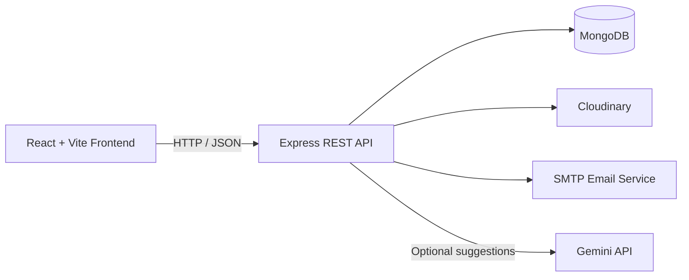

# Memory Capsule

**Preserve a moment today. Revisit it when the time is right.**

Memory Capsule is a time-capsule web application for saving personal memories and opening them in the future. Create capsules with text, images, voice recordings, or video; choose when they become available; and keep them in your personal vault or share them with another registered user.

<p align="center">
  <a href="https://memory-capsule-final.vercel.app/">
    
  </a>
</p>

<p align="center">
  <a href="https://memory-capsule-final.vercel.app/"><strong>🌐 Open Memory Capsule →</strong></a>
</p>

## ✨ Features

### 👤 Accounts and Profiles
- Email registration with one-time verification codes.
- Login, logout, access-token refresh, and password recovery.
- Profile editing and password changes.

### ⏳ Time Capsules
- Create capsules containing text, images, voice recordings, or video.
- Organize capsules by status: locked, unlocked, expired, or destroyed.
- Set future unlock dates, expiration dates, destruction-after-view rules, or event-based unlocks.
- Share capsules with another registered user.

### 🤝 Friends and Sharing
- Search for users.
- Send, accept, and reject friend requests.
- Manage your friends list and choose recipients for shared capsules.

### 👻 Ghost Wall
- Publish text or image posts to a separate feed.
- Set post expiration between 1 and 168 hours.
- React with heart, ghost, or fire.
- Browse up to 50 recent active posts through the API.

### 🤖 AI-Powered Suggestions
- Generate capsule ideas using Google Gemini.
- Optional integration requiring `GEMINI_API_KEY`.

### ☁️ Media and Lifecycle Management
- Cloudinary storage for capsule, profile, and Ghost Wall media.
- File uploads limited to 50 MB and filtered by MIME type.
- Background processing for capsule unlocking, expiration, and destruction.

> **Implementation note:** Socket.IO client and server code is present, but the server initializer is not currently connected to backend startup. Real-time notifications should not be considered operational.

## 🛠️ Tech Stack

| Area | Technologies |
|---|---|
| Frontend | React 19, Vite 8, React Router |
| Backend | Node.js, Express 5 |
| Database | MongoDB, Mongoose |
| Authentication | JSON Web Tokens, bcryptjs, HTTP-only refresh-token cookie |
| Media Storage | Cloudinary, Multer |
| Email | Nodemailer, SMTP |
| AI Integration | Google Generative AI SDK, Gemini |
| UI and Styling | CSS, Google Fonts, Font Awesome, Lucide React |
| Utilities | React Dropzone, React Hot Toast, Canvas Confetti, date-fns |
| Deployment | Vercel |

## 🏗️ Architecture

The React frontend communicates with the Express REST API. The backend stores application records in MongoDB, uses Cloudinary for uploaded media, and sends verification and password-reset emails through SMTP. When configured, the optional AI endpoint sends a contextual prompt to Gemini.



## 📁 Project Structure

```text
.
├── backend/
│   ├── server.js
│   └── src/
│       ├── config/
│       ├── controllers/
│       ├── middleware/
│       ├── models/
│       ├── routes/
│       └── utils/
├── frontend/
│   ├── public/
│   └── src/
│       ├── components/
│       ├── context/
│       ├── pages/
│       └── utils/
├── vercel.json
└── README.md
```

## 🚀 Getting Started

### Prerequisites

- Node.js and npm.
- A MongoDB database.
- A Cloudinary account for media uploads.
- SMTP credentials for verification and password-reset emails.
- Optional: a Gemini API key for AI suggestions.

### 1. Clone the Repository

```powershell
git clone https://github.com/ayushsarkar314/MemoryCapsuleFinal.git
cd MemoryCapsuleFinal
```

### 2. Install Dependencies

```powershell
cd backend
npm install

cd ..\frontend
npm install
```

### 3. Configure Environment Variables

Create a `backend/.env` file and configure the variables listed in the Environment Variables section.

### 4. Start the Backend

```powershell
cd backend
npm run dev
```

The backend defaults to `http://localhost:5000`.

### 5. Start the Frontend

Open another terminal from the project root:

```powershell
cd frontend
npm run dev
```

The frontend defaults to `http://localhost:5173`.

## 🔐 Environment Variables

Configure these values in your local environment or deployment platform. Never commit real credentials.

| Variable | Purpose |
|---|---|
| `MONGO_URI` | MongoDB connection string |
| `JWT_ACCESS_SECRET` | Access-token signing secret |
| `JWT_REFRESH_SECRET` | Refresh-token signing secret |
| `CLOUDINARY_CLOUD_NAME` | Cloudinary cloud identifier |
| `CLOUDINARY_API_KEY` | Cloudinary API key |
| `CLOUDINARY_API_SECRET` | Cloudinary API secret |
| `SMTP_HOST` | SMTP server host |
| `SMTP_PORT` | SMTP server port |
| `SMTP_USER` | SMTP username |
| `SMTP_PASS` | SMTP password or app password |
| `SMTP_FROM` | Sender identity for application emails |
| `PORT` | Backend port; defaults to `5000` |
| `CLIENT_URL` | Frontend origin allowed by CORS |
| `JWT_ACCESS_EXPIRE` | Access-token lifetime |
| `JWT_REFRESH_EXPIRE` | Refresh-token lifetime |
| `OTP_EXPIRY_MINUTES` | Password-reset expiry setting |
| `GEMINI_API_KEY` | Optional Gemini integration |
| `CRON_SECRET` | Optional cron endpoint protection |
| `NODE_ENV` | Runtime environment |
| `VITE_API_URL` | Frontend API base URL |

## 🔄 How It Works

1. A user registers with an email and password.
2. The application sends an email verification code.
3. After verification, the user can sign in and access their personal vault.
4. The user creates a capsule, adds content, and chooses when it unlocks or expires.
5. Capsules can be shared with friends and opened when their rules permit.
6. Users can manage friend requests and publish temporary posts on the Ghost Wall.
7. Profile management and password recovery are available through the account system.

## 🔌 API Overview

The following endpoints are mounted under `/api`. Protected endpoints require authentication unless otherwise noted.

| Method | Endpoint | Purpose |
|---|---|---|
| `GET` | `/health` | API health check |
| `POST` | `/auth/register` | Start registration |
| `POST` | `/auth/verify-otp` | Verify registration code |
| `POST` | `/auth/login` | Authenticate a user |
| `POST` | `/auth/refresh` | Refresh access token |
| `POST` | `/auth/forgot-password` | Request password recovery |
| `POST` | `/auth/reset-password` | Reset password |
| `GET` | `/auth/me` | Get current user |
| `PUT` | `/auth/profile` | Update profile |
| `POST` | `/auth/change-password` | Change password |
| `GET` | `/capsules/vault` | List personal capsules |
| `GET` | `/capsules/sent` | List sent capsules |
| `GET` | `/capsules/received` | List received capsules |
| `POST` | `/capsules` | Create a capsule |
| `GET` | `/capsules/:id` | View an accessible capsule |
| `DELETE` | `/capsules/:id` | Delete a capsule |
| `POST` | `/capsules/:id/trigger` | Trigger an event-based capsule |
| `GET` | `/friends` | List friends |
| `GET` | `/friends/requests` | List friend requests |
| `GET` | `/ghost` | List active Ghost Wall posts |
| `POST` | `/ghost` | Create a Ghost Wall post |
| `POST` | `/ghost/:id/react` | React to a post |
| `POST` | `/ai/suggest` | Generate capsule suggestions |
| `POST` | `/cron` | Run scheduled lifecycle tasks |

## 🚢 Deployment

Memory Capsule is deployed on Vercel.

**Live application:** https://memory-capsule-final.vercel.app/

The repository includes a `vercel.json` configuration for frontend and backend builds, API rewrites, and a scheduled cron route.

Deployment requires the correct environment variables, database access, Cloudinary configuration, SMTP credentials, and frontend/backend URL settings.

**Lifecycle note:** The local backend scheduler runs every minute, while the configured Vercel cron schedule runs daily. Verify that this schedule meets the intended capsule unlocking and expiration requirements.

## 🛡️ Security and Privacy

- Passwords for permanent user accounts are hashed using bcryptjs.
- Refresh tokens use HTTP-only cookies.
- Access tokens are stored in browser `localStorage`, which has security implications.
- Keep API keys and credentials out of source control.
- AI suggestions may send profile details, friend names, and recent capsule summaries to Gemini.
- Ghost Wall records do not include an author reference, but this does not guarantee anonymity.
- The project does not currently document end-to-end encryption or a completed security audit.

## 🤝 Contributing

Contributions, bug reports, and feature suggestions are welcome.

1. Fork the repository.
2. Create a branch for your changes.
3. Install dependencies in both `backend/` and `frontend/`.
4. Run relevant checks, including `npm run lint` and `npm run build` in `frontend/`.
5. Submit a pull request describing your changes.

Please do not commit credentials, private data, or environment files.

## 📄 License

No root-level license file is currently present. The project license has not yet been specified.
